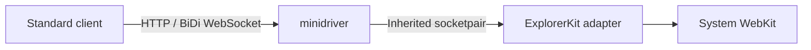

# Automating macOS system WebKit views

Native Rust hosts can let a standard WebDriver client automate ordinary existing
and newly created ExplorerKit system views. This experimental adapter reuses
patched minidriver and macOS WebKit. The host keeps control of layout, helper
processes and which views are eligible. It does not need an OS-window manager.

For supported operations, tested runtimes and known native defects, see
[automation capabilities](capabilities.md#native-automation).

## Enable the adapter

Enable `macos-webkit-automation` on the `explorerkit` dependency. It includes
`macos-webkit`; it does not include Servo. Adding `servo` includes both engines,
but this automation connection still controls only eligible system views.

```toml
explorerkit = { path = "path/to/explorerkit", features = ["macos-webkit-automation"] }
```

Get the control handle before moving the host into the Runtime:

```rust
let automation = host.webkit_automation();
let mut runtime = Runtime::new(host);
let session = runtime.create_session();
let options = MacOsWebViewOptions::new(MacOsWebViewKind::SystemWebView)
    .with_webkit_automation(true);
let view = runtime.create_webview_with_options(session, options)?;
```

Attach the view to a host-provided surface as usual. The flag defaults to
`false`. To enroll an existing system view without replacing its page, call
`automation.set_view_automation(view, true)`. It can also store eligibility for
a logical view awaiting its first attachment. Children created through the
native popup path inherit their source's eligibility.

The control handle is weak: it does not keep the host, Runtime or views alive.
Use it only on the AppKit thread. Methods return an error after the host is
dropped. Enabling automation for a Servo view, or without the feature, returns
an error. There is no mixed-engine session or new React Native/mobile binding.

## Connect the helper

The host creates a connected Unix socket pair. It passes one endpoint as an
`OwnedFd` to `automation.connect` and inherits the other into minidriver:



The helper uses `--attach-fd=3`, local listener options and the host-selected
ports. Inheritance must duplicate the connected endpoint to the chosen child
FD; simply passing the parent's FD number is insufficient if it closes on exec.
The host owns launch, executable location, signing, termination and reaping.
The SDK does not spawn processes or choose ports. The retained driver patches
and build instructions are in the [dependency reference](dependencies.md#local-patches).
The [native host example](../../crates/explorerkit/examples/webkit-automation/main.rs)
demonstrates descriptor inheritance, helper ownership and the Runtime event loop.

`connect` consumes its FD on both success and failure. At least one eligible
view must already have a native instance and process pool. It does not create a
startup view. A successful return means the SDK adopted the connection;
`AwaitingSession` becomes `Active { session_id }` after standard session setup.
Missing native APIs and connection failures report errors without disabling
ordinary browsing. One active connection is supported per participating pool.

Run the standard client away from AppKit, keep the host event loop pumping,
and use the ordinary Runtime wake/update/event-drain path. Blocking AppKit on
an HTTP command also blocks the native work that would answer it.

The inherited socket has no listener. Minidriver's client listeners remain
local trusted-client interfaces; localhost is not per-agent authentication.
The host controls access to its automation tools. Eligibility controls native
enumeration, not authorization for arbitrary clients with a protocol endpoint.

## Select a particular view

Call `automation.context(view)` after pairing. It returns a native context
handle together with the automation session ID. Pass that handle to standard
Switch To Window, or to a BiDi command accepting a context, only in the matching
session. Do not use enumeration order as SDK identity. Reconnecting creates a
new automation session and may change all native handles.

An SDK `WebViewHandle` is local to its Runtime. The caller must not pass a handle
from another Runtime: numeric handle collisions cannot identify foreign views.
Before pairing, or before a native instance exists, `context` returns `None`.
Unknown, retired, ineligible and Servo views return an error.

Native selection works without a presentation callback. If your layout hides
views, the optional
`with_webkit_automation_view_selection_handler(Rc<dyn Fn(WebViewHandle)>)`
hook can reveal the selected view synchronously. It must operate on independently
retained UI state, without calling Runtime, the automation control or a nested
event loop. Selection does not imply OS application activation. Trusted input
still needs the native visibility/focus conditions.

Classic selection is session-wide. A host running several agent workflows must
coordinate their selection and commands; the SDK does not add an input scheduler.

## Create ordinary views through the protocol

[WebDriver New Window](https://www.w3.org/TR/webdriver2/#new-window) and
[BiDi `browsingContext.create`](https://www.w3.org/TR/webdriver-bidi/#command-browsingContext-create)
request new browsing contexts. They can be additional SDK views inside the
same host OS window.
The protocol's tab/window option is a presentation hint, not a requirement for
an SDK tab or window manager.
Creation success does not mean the initial document has finished loading. Wait
for its native load event before inspecting the new context's tree; see the
[observed BiDi limits](capabilities.md#native-automation).

Drain `automation.drain_new_view_requests()` from your ordinary AppKit turn.
Each request supplies an opaque ID and `prefer_new_tab`. Use existing Runtime
creation and attachment outside native callbacks, then call
`resolve_new_view_request(id, Some(view))`. If creation/attachment fails, destroy
any partially created view through Runtime and resolve the request with `None`.
The native command receives WebKit's existing creation error.

The supplied view must be attached, eligible, in the same host/pool, logically
created after the request was registered, and not claimed by another request.
The host also asserts that it created the candidate for this request. An older
logical view first attached later is still an existing view, not a candidate.

| Result of resolving a request | Ownership |
| --- | --- |
| `Ok(())` | SDK accepted and settled the request. Native success leaves an ordinary live view; native rejection retires an unused candidate. The protocol may still report an error. |
| `Err` before adoption | Host retains its supplied view. Local validation leaves a valid pending request available to resolve with `None`; a stale request remains stale. |
| Session ends before host supplies a candidate | Pending token is invalidated. A late resolution cannot target the next session and does not adopt or destroy a newly supplied host view. |

All fallible host work happens before native dispatch. On success, WebKit's
callback receives the prepared real view immediately. On failure, the adapter
uses the native absent-creation-method error path; it never passes a nil view
into the native completion or leaves that completion waiting for host work.
Original command bytes and native validation, replies and events stay native.

After native rejection retires an unused candidate, another resolution can
return a local retirement error until the ordinary Runtime update releases that
native owner. This error occurs before adoption: keep the same request and
candidate, update the Runtime, then retry. Disconnect immediately invalidates
pending requests instead; a stale request cannot be retried in a new session.

Preparation can create a temporary view before native validation rejects an
invalid request. Its retirement can emit real lifecycle events despite the
failed command. This is documented partial protocol support, not atomic
invalid-request behavior; the adapter does not rewrite events to conceal it.

## Handle page dialogs

Opting a view into automation also opts it into the existing SDK dialog flow.
Handle `SimpleDialogRequested` and answer through `Runtime::resolve_simple_dialog`
or the existing controller command. Native [driver dialog commands](https://www.w3.org/TR/webdriver2/#user-prompts) and host answers
use the same Rust pending record. The first valid answer consumes it; a later
answer is stale and cannot invoke the native completion again.
For a prompt, driver text updates become the current shared value. A host
acceptance without an explicit value accepts that current text.

There is no SDK timer or automatic answer for an opted-in host that neglects
its events. Non-opted system views keep their native defaults. Opt-in does not
adopt a dialog that was already open. Turning eligibility off is rejected while
a session is connected or a captured dialog is pending.

Disconnecting automation leaves a live view's dialog with its host/controller.
Closing the view or ending its content process retires the pending record and
completes the native block once using WebKit's own terminal defaults: finish an
alert, cancel a confirm, or return null for a prompt. Popup, file and media
delegates retain their existing behavior.
Explicit Runtime destruction preserves the terminal `SimpleDialogDismissed`
receipt while discarding ordinary queued events for the destroyed view.

## End automation without closing the browser

Delete Session, stream loss and `automation.disconnect()` end the automation
connection. They preserve host-owned views and their documents. The host stops
and reaps its helper. Reconnect with a new helper/socket/session: `--attach-fd`
is consumed only once. Closing only the BiDi WebSocket does not end the native
Classic session.

Explicit protocol Close Window closes its selected SDK view; it is distinct
from ending automation. Ordinary surface detach preserves the live view and
its eligibility. Runtime shutdown ends the connection before releasing its
views and pool. Pending preparation tokens can be discarded because they do
not own mandatory native creation completions.

See [native automation validation](testing.md#macos-webkit-automation) for the
public-API acceptance command and when to rerun it.
